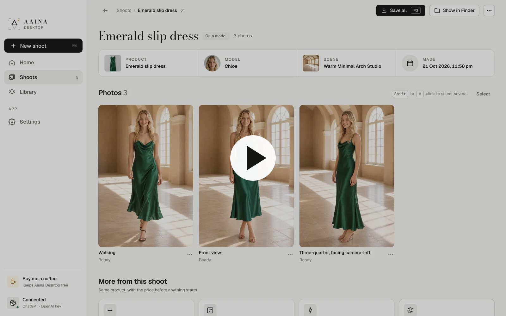

# Aaina Desktop

**Model photos of your products, made on your own computer. Free and open source.**

[](https://desktop.aaina.world/tutorials#video)

Add a photo of what you sell, pick a studio model, choose poses and a scene, and get photos you can use in your shop. There is no account to make. Your shoots, photos and models stay on your computer.

**[Watch the demo](https://desktop.aaina.world/tutorials#video)** (3 minutes, with sound; also [as a file](docs/media/aaina-desktop-demo.mp4)) · **[Tutorials](docs/tutorials/README.md)** · **[Download](#download)** · **[Install from source](#install-from-source)**

## Why this exists

Good product photos sell, but a photoshoot with a model, a studio and a photographer is out of reach for most people starting out. [Aaina](https://aaina.world) makes those photos with AI. We used AI to build Aaina Desktop: a part of Aaina, rebuilt as a free, open-source app, so that anyone starting a business, or anyone without the money for photoshoots or subscriptions, can have studio-quality photos of what they sell from day one.

There is no subscription and nothing to buy from us. You bring your own OpenAI account and pay OpenAI only for the photos you make, a few cents each. The studio models, poses and scenes come with the app, and everything you make stays on your computer.

## Download

Get the latest version from the **[releases page](https://github.com/aaina-world/aaina-desktop/releases/latest)**:

| System | File | How to install |
|---|---|---|
| **Mac** (Apple silicon and Intel) | `Aaina.Desktop_<version>_universal.dmg` | Open the `.dmg` and drag Aaina Desktop into Applications. |
| **Windows** 10 and 11 | `Aaina.Desktop_<version>_x64-setup.exe` (or `_x64_en-US.msi`) | Run it and follow the steps. |
| **Linux**, Debian or Ubuntu | `Aaina.Desktop_<version>_amd64.deb` | `sudo apt install ./Aaina.Desktop_<version>_amd64.deb` |
| **Linux**, Fedora or openSUSE | `Aaina.Desktop-<version>-1.x86_64.rpm` | `sudo dnf install ./Aaina.Desktop-<version>-1.x86_64.rpm` |
| **Linux**, any | `Aaina.Desktop_<version>_amd64.AppImage` | `chmod +x Aaina.Desktop_*.AppImage`, then open it. |

The first builds are not signed yet, so your system warns you once:

- **Mac:** open the app once (it says it can't be checked), then go to System Settings, Privacy and Security, and choose **Open Anyway**.
- **Windows:** if SmartScreen appears, choose **More info**, then **Run anyway**.

The app can tell you when a new version is out (Settings, Updates). It never installs anything without you.

## Quick start

1. **Open the app** and press Get started.
2. **Connect OpenAI.** Sign in with ChatGPT if you have it (optional), and paste your OpenAI key ([how to get one](#getting-an-openai-key)). Press Check key.
3. **Choose your photos folder.** Every photo you make is kept there as a normal file.
4. **New shoot:** add a photo of your product, pick a model, up to six poses and a scene.
5. **Review** shows the price before anything is sent. Press **Make photos**; each one takes about a minute.
6. **Open a photo** to compare it with your product, Make again, Fix something or try Other colours, then **Save photo** in the shape your marketplace wants.

## Tutorials

Short guides with pictures, a few minutes each. They are also on the [website](https://desktop.aaina.world/tutorials), with the demo video.

1. [Getting started](docs/tutorials/01-getting-started.md): install, connect OpenAI, why there is a ChatGPT sign-in, and how to get an OpenAI key.
2. [Your first shoot](docs/tutorials/02-first-shoot.md): product, model, poses, scene, review and make.
3. [Edit and save photos](docs/tutorials/03-edit-and-save.md): Make again, Fix something, Other colours, Frame and expression, saving.
4. [Ghost mannequin and flat-lay](docs/tutorials/04-ghost-and-flat-lay.md): the product on its own, without a model.
5. [Your own models](docs/tutorials/05-own-models.md): from a description, or from photos of a real adult who agrees.
6. [Your own poses and scenes](docs/tutorials/06-own-poses-and-scenes.md): in words or from a photo, and plain colours.
7. [Shoots and Library](docs/tutorials/07-shoots-and-library.md): find, reuse and tidy what you made.
8. [Settings, backup and privacy](docs/tutorials/08-settings.md): quality, folders, the offline catalogue, backups, and what is sent where.

## What it does

- Model photos of a product with a studio model, poses and a scene.
- Make again, Try again, Fix something and Other colours on any photo.
- Flat-lays and ghost mannequin photos.
- Your own poses, scenes and models (from a description, or from photos of a real adult who agrees).
- Saves JPEG or PNG, square and marketplace shapes, marked as AI-made inside the file, with a shoot history you can search.
- Backup and restore, light and dark, and the studio catalogue kept for offline use.

Videos, try-ons and listings are on [Aaina](https://aaina.world).

## ChatGPT and your OpenAI key

- **Sign in with ChatGPT** (optional): every reading (your product, a pose in a photo, the checks on a model you make) uses your ChatGPT plan, at no cost to your key.
- **Your OpenAI key**: makes the photos, poses, scenes and models, billed by OpenAI. Without ChatGPT it also does the readings (a fraction of a cent each). If ChatGPT can't answer, the key reads instead.

ChatGPT plans can't make pictures in other apps yet; photos switch over when OpenAI allows it.

### Getting an OpenAI key

1. Make or sign in to an account at [platform.openai.com](https://platform.openai.com). It is OpenAI's developer site, separate from a ChatGPT subscription.
2. Add a little credit under Billing. $5 is about 100 standard photos.
3. Open [API keys](https://platform.openai.com/api-keys), make a new key and copy it.
4. Paste it in Aaina Desktop and press Check key.

OpenAI may ask you to verify your organisation before it lets you make photos. That is a step on their side and usually quick. More in [Getting started](docs/tutorials/01-getting-started.md).

## Cost

Aaina Desktop is free. Photos are made with your own OpenAI account, and OpenAI bills you directly: about **$0.05 a photo** at standard quality and $0.20 at high. The app shows the rough cost before every paid action, and a photo OpenAI refuses isn't charged. The full list is in the [tutorials](docs/tutorials/README.md#costs-at-a-glance).

## What stays on your computer, and what is sent where

Everything you make is kept on your computer: shoots, photos, own models, settings. Your OpenAI key is kept in your system keychain.

- **OpenAI** gets your product photos, plus the model, pose and scene for each photo, so it can make the photo. It is sent with your own key or ChatGPT sign-in.
- **Aaina** gets nothing from you. The app only downloads the public catalogue of studio models, poses and scenes.
- **No tracking in the app.** No analytics, no accounts, no ads.

More in [PRIVACY.md](PRIVACY.md).

## Install from source

Aaina Desktop is a [Tauri 2](https://tauri.app) app: a Rust shell with React and TypeScript screens.

### What you need

- **Node.js 22** or newer, and npm.
- **Rust** stable, from [rustup.rs](https://rustup.rs).
- **Mac:** Xcode Command Line Tools (`xcode-select --install`).
- **Windows:** Microsoft C++ Build Tools ("Desktop development with C++") and WebView2 (already on Windows 11).
- **Linux** (Debian or Ubuntu):

  ```bash
  sudo apt install libwebkit2gtk-4.1-dev libappindicator3-dev librsvg2-dev patchelf libsecret-1-dev libssl-dev build-essential curl wget file
  ```

  For other distributions, see the [Tauri prerequisites](https://tauri.app/start/prerequisites/).

### Run and build

```bash
git clone https://github.com/aaina-world/aaina-desktop.git
cd aaina-desktop
npm ci
npm run tauri dev       # run the app, reloading as you edit
npm run tauri build     # make installers for this computer
```

The installers land in `src-tauri/target/release/bundle/` (`dmg/` and `macos/` on a Mac, `msi/` and `nsis/` on Windows, `deb/`, `rpm/` and `appimage/` on Linux). For a Mac build that runs on both Apple silicon and Intel, add the targets once with `rustup target add aarch64-apple-darwin x86_64-apple-darwin`, then run `npm run tauri build -- --target universal-apple-darwin`.

### Without the native shell

`npm run dev` opens the screens in a browser with sample data and no network, which is the quickest way to work on the interface. Add `?demo` to the address for the tutorial samples, or `?firstrun` to see the welcome screens.

### Checks

```bash
npm run check                         # types, lint and unit tests
npm run test:e2e                      # end-to-end tests in Chromium
cd src-tauri && cargo test && cargo clippy
```

Releases are built by GitHub Actions when a `v*` tag is pushed (`.github/workflows/release.yml`). Each Windows and Linux build is then installed on a fresh machine, opened, checked to keep running, and photographed: the screenshots are under Artifacts on the workflow run. `.github/workflows/linux-check.yml` (run it from the Actions tab) opens a release's Linux build again on its own, for a closer look. The tutorial screenshots and the demo video are made from the app's own screens; see [docs/tools/demo](docs/tools/demo/README.md).

## Contributing

Ideas, bug reports and pull requests are welcome. Start with [CONTRIBUTING.md](CONTRIBUTING.md) and [ARCHITECTURE.md](ARCHITECTURE.md).

## Support the project

Aaina Desktop is free. If it saves you time, you can [buy me a coffee](https://buymeacoffee.com/aaina.world), sponsor on [GitHub Sponsors](https://github.com/sponsors/aaina-world), or just star the repository.

## Licence

The code is MIT licensed ([LICENSE](LICENSE)). The studio models, poses and scenes belong to Aaina and are licensed only for use inside Aaina Desktop. See [CATALOGUE-TERMS.md](CATALOGUE-TERMS.md). The photos you make are yours.
