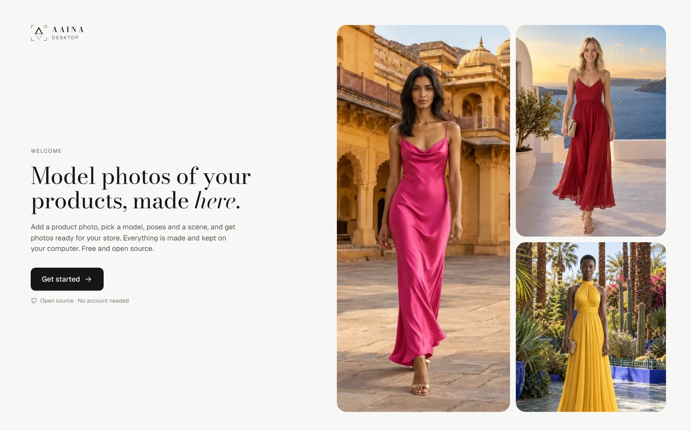
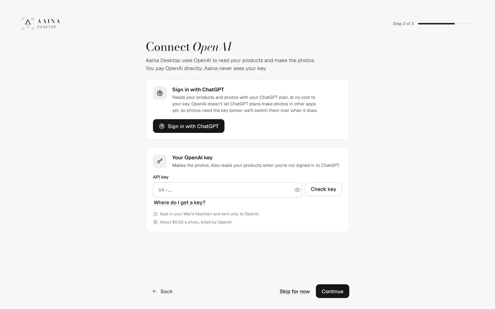
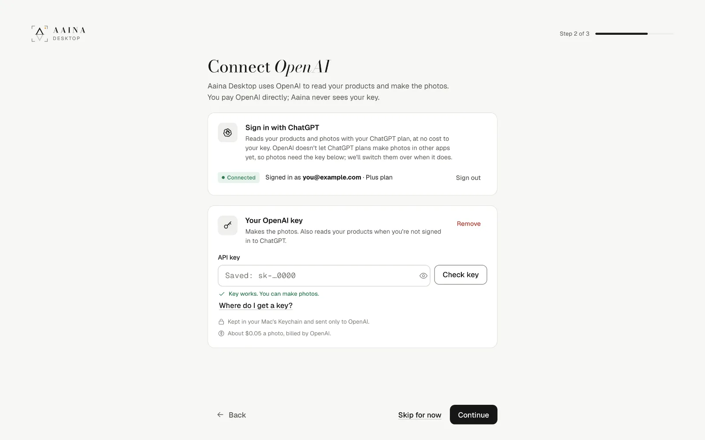
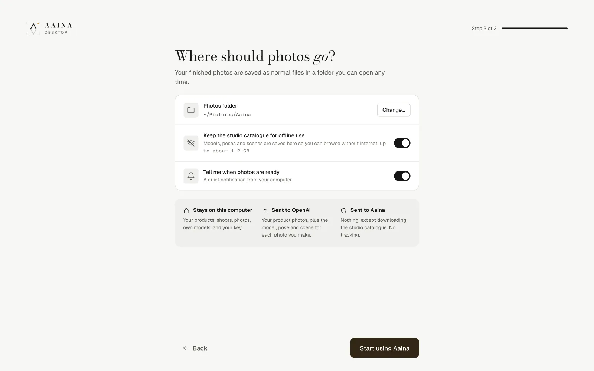
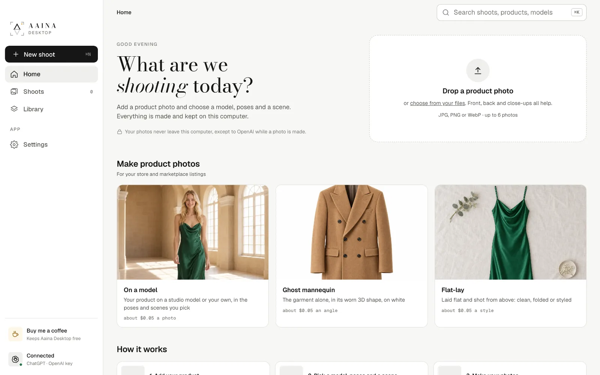

# 1. Getting started

## Install

Download the app for your computer from the [releases page](https://github.com/aaina-world/aaina-desktop/releases/latest): a `.dmg` for Mac, an `.msi` or `-setup.exe` for Windows, an `.AppImage`, `.deb` or `.rpm` for Linux.

The first builds are not signed yet, so your computer may warn you once:

- **Mac:** open the app once, then go to System Settings, Privacy and Security, and choose Open Anyway.
- **Windows:** choose More info, then Run anyway.

There is no account to make. Everything you do stays on your computer.

## Connect OpenAI

Aaina Desktop does not run its own servers. Photos are made by OpenAI's image model with **your own OpenAI key**, so you pay OpenAI directly for what you make, at their price, with nothing added. That is what lets the app be free.

There are two ways to connect, and you can use both:

### Sign in with ChatGPT (optional, recommended if you have ChatGPT)

Before it makes a photo, the app *reads* your product: what it is, its colour, fabric and details, and who it is for. That reading picks the right poses and models for you, and it is what the photo is checked against. It also reads a pose from a photo you show it, and checks the models you make.

When you sign in with ChatGPT, **every reading uses your ChatGPT plan**, at no cost to your key. If ChatGPT can't answer, the key reads instead, so nothing stops.

ChatGPT plans can't make pictures in other apps yet, so photos still need the key. The app will switch photos over when OpenAI allows it.

### Your OpenAI key (needed to make photos)

The key makes the photos, poses, scenes and models, billed by OpenAI. Without ChatGPT it also does the readings, for a fraction of a cent each.

The key is kept in your computer's keychain and is only ever sent to OpenAI.

## How to get an OpenAI key

1. Go to [platform.openai.com](https://platform.openai.com) and sign up or sign in. This is OpenAI's developer site; it is a separate account from a ChatGPT subscription, though you can use the same email.
2. Open **Settings, Billing** and add a little credit. $5 is plenty to start: about 100 standard photos.
3. Open **[API keys](https://platform.openai.com/api-keys)**, choose **Create new secret key**, give it a name like "Aaina Desktop", and copy it. OpenAI shows it only once.
4. In Aaina Desktop, paste it into **API key** and press **Check key**. "Key works" means you are ready.

OpenAI may ask you to **verify your organisation** before it lets a new account make pictures. If the app says so, follow the link it shows; it is a step on OpenAI's side and is usually quick.

Good to know:

- You can set a monthly spending limit in OpenAI's billing settings.
- If a key is ever shared by mistake, delete it on the API keys page and make a new one.

## Where photos go

Every photo you make is kept as a normal file in your **photos folder** (`Pictures/Aaina` unless you pick another), one folder per shoot. Here you can also keep the studio catalogue on your computer, so you can browse models, poses and scenes without internet, and turn on a notification for when photos are ready. All of this can be changed later in Settings.

Then you are on Home: start a shoot from the big drop area, or pick what you want to make.

Next: [Your first shoot](02-first-shoot.md)
