# 2. Your first shoot

A shoot is one product on one model, in one scene, in up to six poses. Each pose becomes one photo. Start one with **New shoot** in the sidebar (or ⌘N / Ctrl+N), or by dropping a product photo on Home.

## 1. Add your product

Choose **On a model**, then add a clear photo of what you sell: on a hanger, laid flat, or worn. One photo is enough. A photo of the back and a close-up of a print or fabric make the result more faithful; mark each one as **Front**, **Back** or **Close-up**.

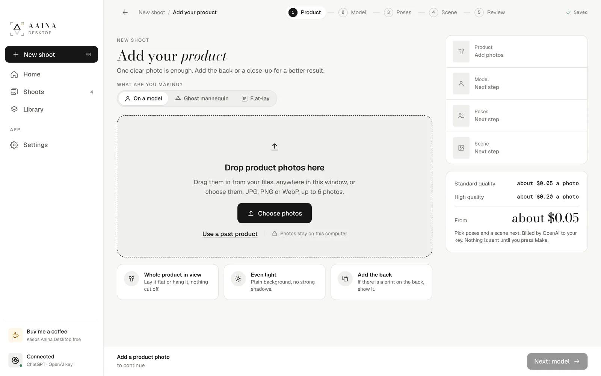

Tips for the product photo:

- The whole product in view, nothing cut off.
- Even light, a plain background, no strong shadows.
- If there is a print on the back, add the back.

As soon as the photo is in, the app reads it and shows **What we see**: the kind of product, colour, material and details, and who it is for. Check it and change anything that is wrong; it guides the suggestions and the photo. The small label says who read it (ChatGPT or your key).

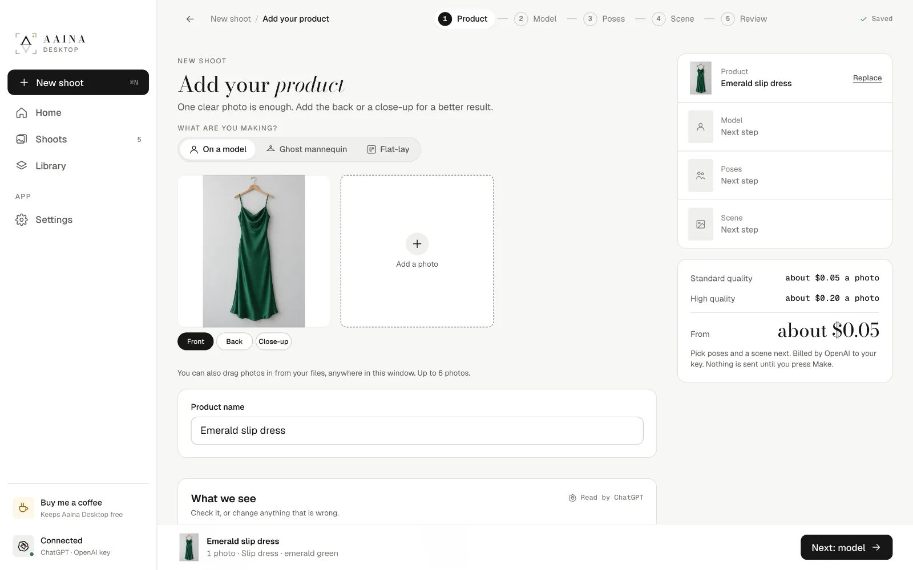

Already used this product before? **Use a past product** picks it from your Library instead.

## 2. Pick a model

Models suggested for your product come first, best fit first. Search in plain words ("woman, South Asian, plus size") or use the filters for gender, age, look, body and collections (modest, maternity and more). Your own models are at the top; see [Your own models](05-own-models.md).

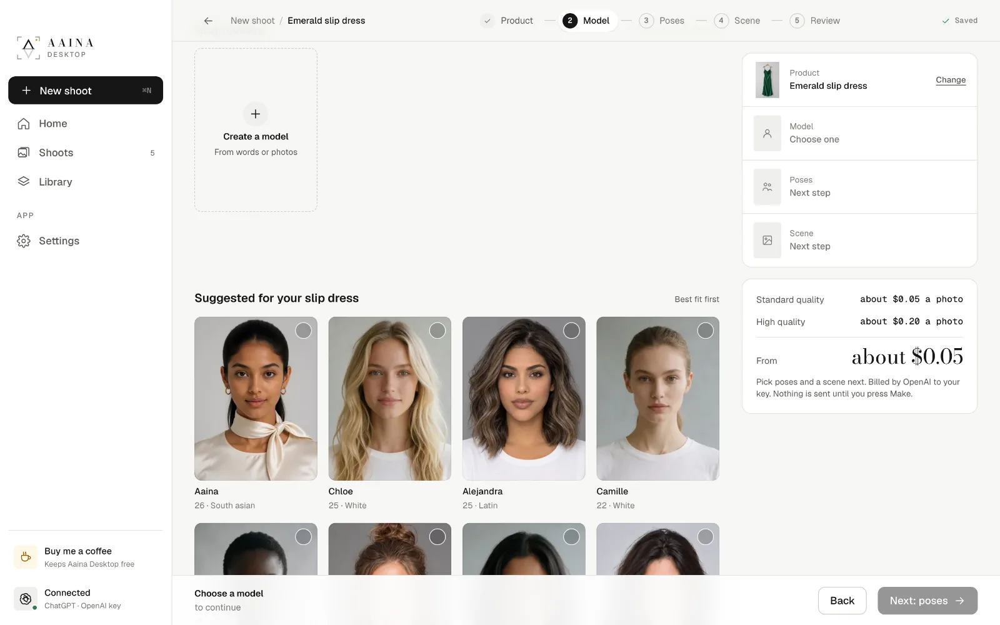

Pick one and the summary on the right updates.

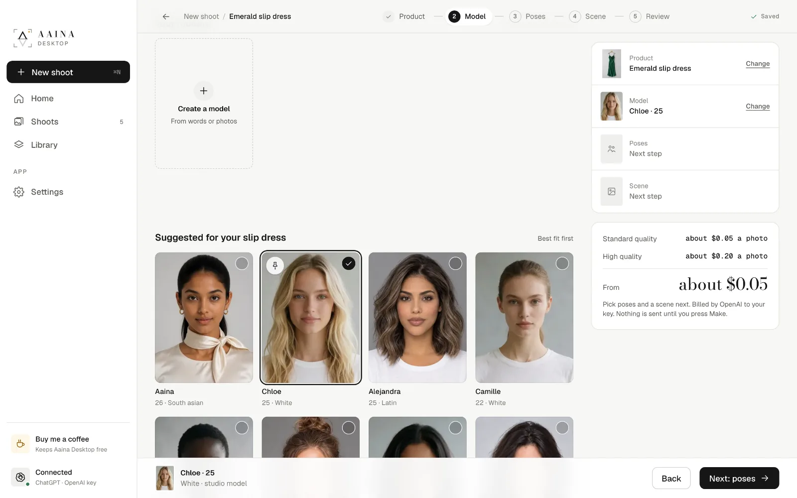

## 3. Choose poses

Poses made for your kind of product come first. **All** shows every pose for this model; **Yours** shows poses you made. Filter by **Framing** (full length, waist up, close-up and so on) or **Style**, or search. Pick up to six.

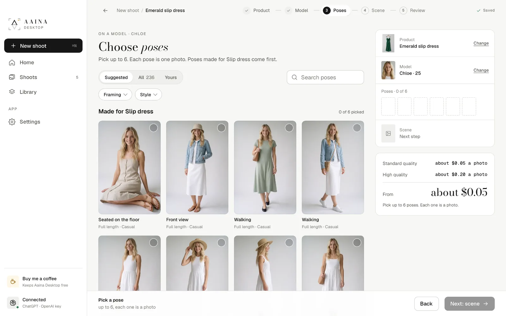

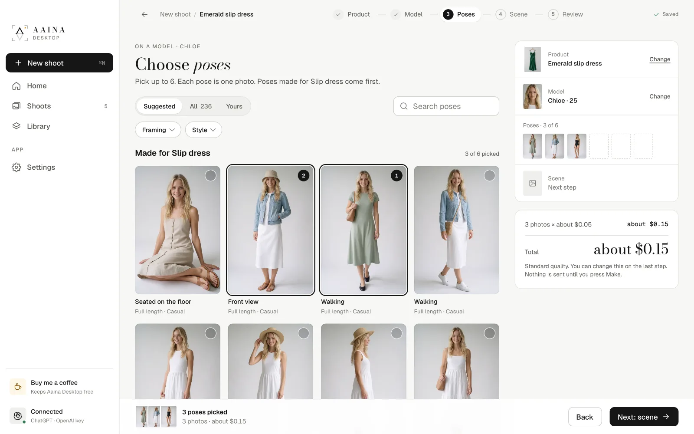

## 4. Pick a scene

The scene is where the photo is set. **Scenes** are studio-made places; scenes that suit your product come first, and **Region** filters by part of the world. White studio is the safest choice for most marketplaces.

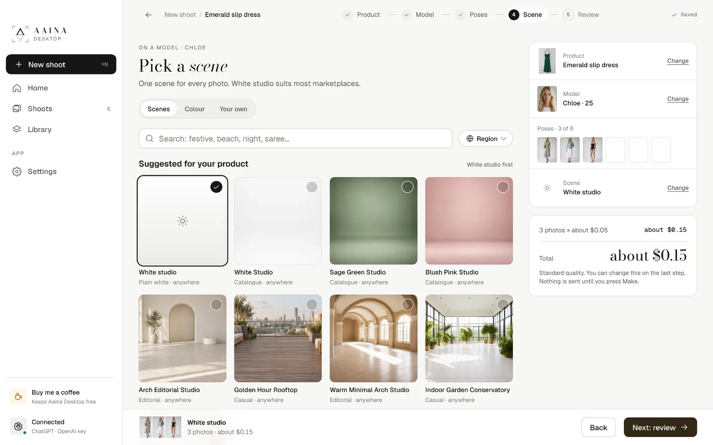

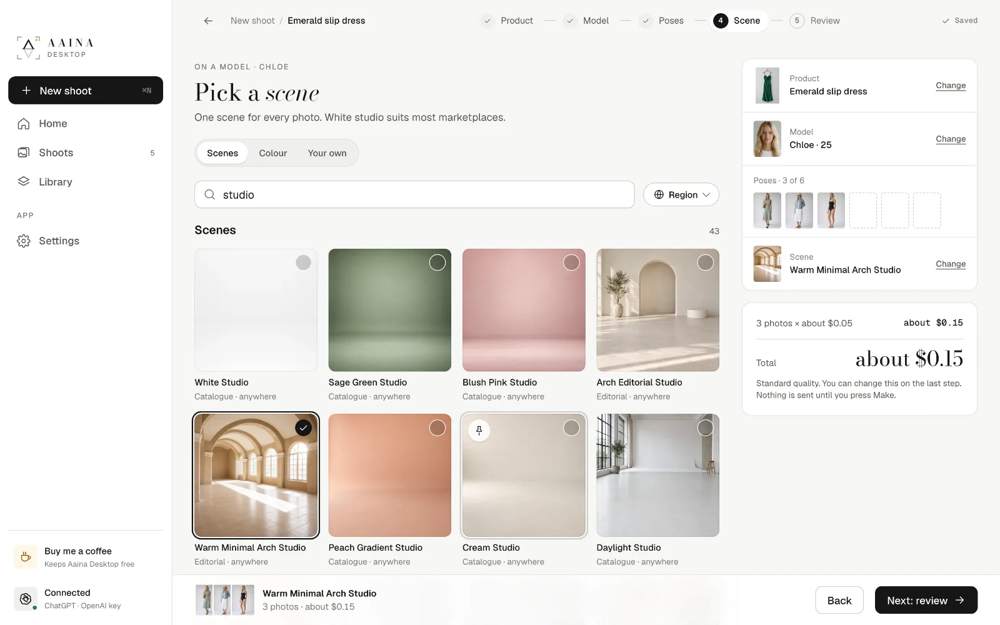

**Colour** gives a plain backdrop in any colour, free. Pick a swatch or type a hex code.

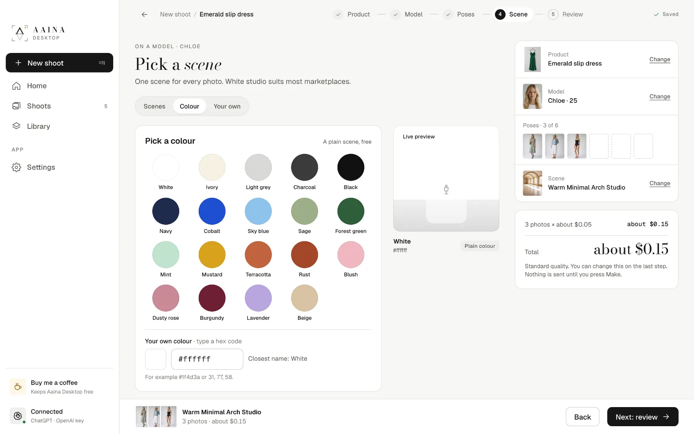

**Your own** holds scenes you made from words or a photo; see [Your own poses and scenes](06-own-poses-and-scenes.md).

## 5. Review and make

Check everything once more. For each pose you can set the **Frame** (as posed, full length, head to knee, waist up, close-up) and the **Expression** (neutral, soft smile, big smile, serious, looking away). Choose **Standard** or **High** quality; the total is shown before anything is sent.

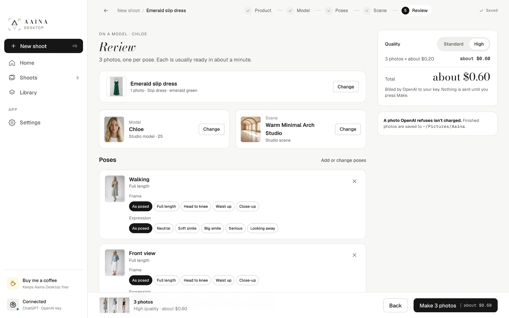

Press **Make photos**. The shoot page shows each photo while it is being made, usually about a minute each. You can leave the page; it keeps going, and the app can tell you when they are ready.

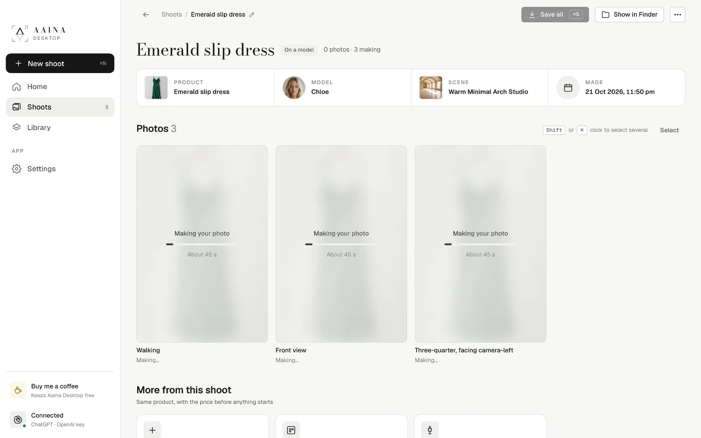

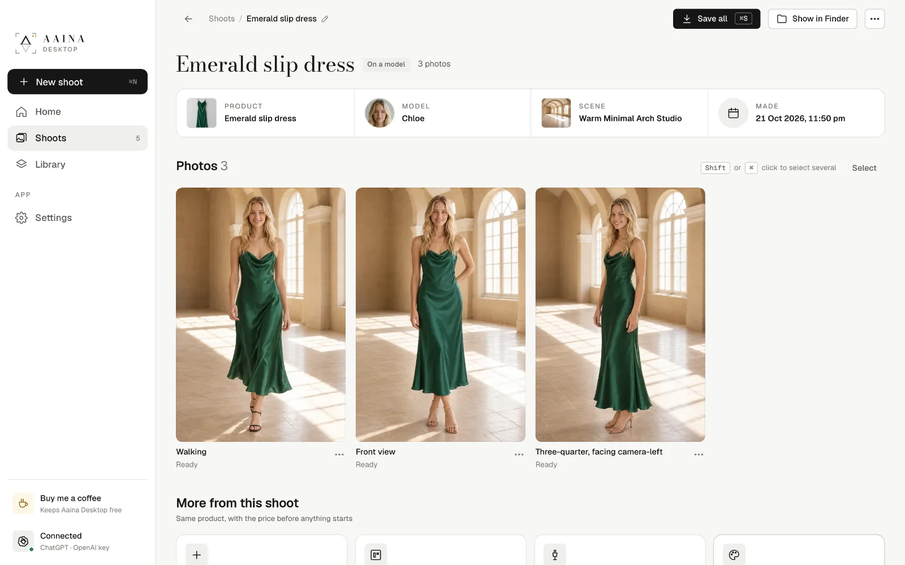

**More from this shoot** at the bottom adds poses, a ghost mannequin or a flat-lay of the same product.

Next: [Edit and save photos](03-edit-and-save.md)
