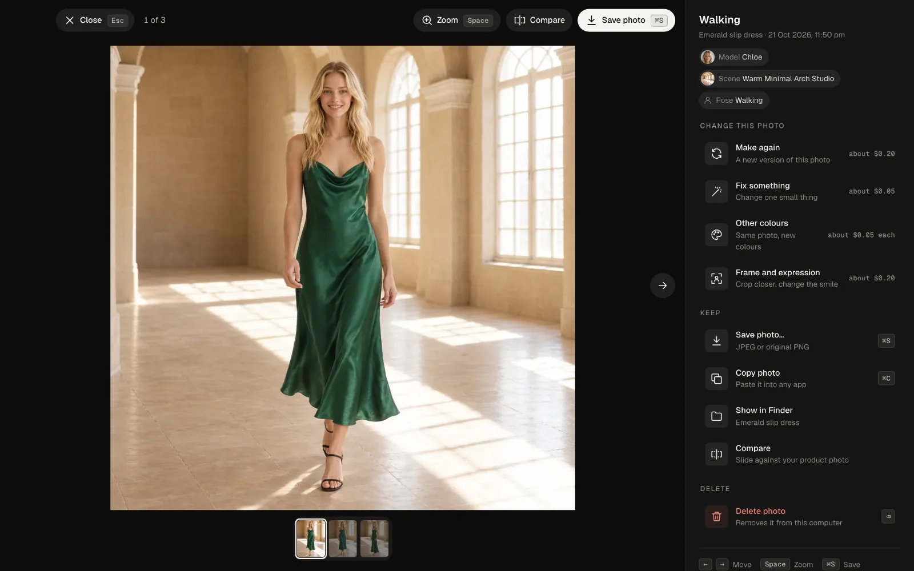
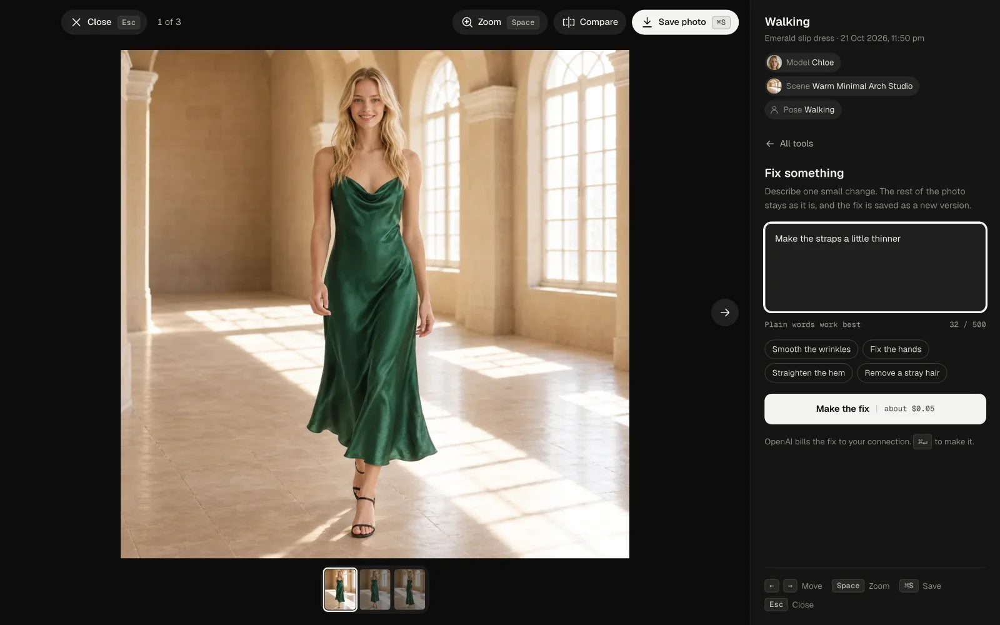
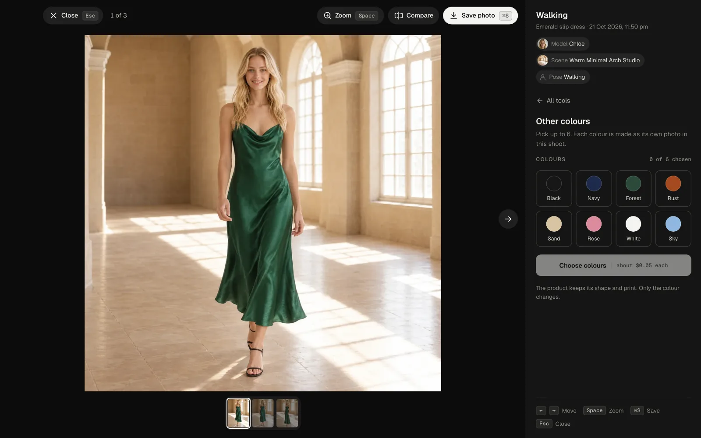
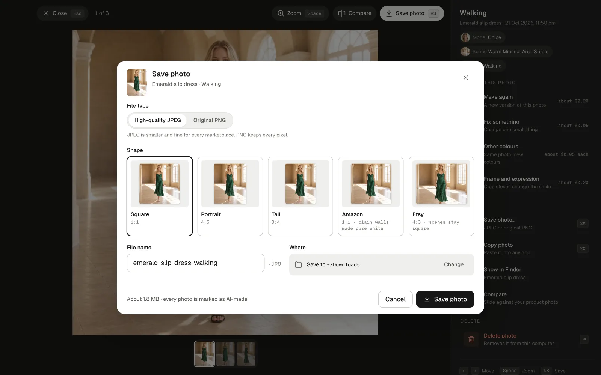

# 3. Edit and save photos

Click any photo to open the viewer. Move between photos with the arrow keys or the strip at the bottom, **Zoom** with the space bar, and **Compare** slides the photo against your product photo so you can check every detail.

## Change this photo

Every change makes a new **version**; earlier versions are kept in the photo's versions list.

- **Make again:** a new version of the same photo, made fresh from the same choices.
- **Fix something:** one small change, the rest stays as it is. Plain words work best: "Smooth the wrinkles", "Fix the hands", "Straighten the hem".
- **Other colours:** the same photo with the product in other colours, up to six at once, one new photo per colour. The shape and print stay; only the colour changes.
- **Frame and expression:** crop closer or change the smile, without starting over.

If something fails, **Try again** is shown on the photo. A photo OpenAI refuses is not charged.

## Save

**Save photo** (⌘S / Ctrl+S) saves a copy where you choose:

- **High-quality JPEG** (small, right for every marketplace) or **Original PNG** (every pixel).
- **Shape:** square, portrait 4:5, tall 3:4, or a marketplace's own shape, such as Amazon (1:1, plain walls made pure white) or Etsy (4:3).
- **File name** and **where** to save it.

**Save all** on the shoot page saves every photo of the shoot at once. **Copy photo** puts it on the clipboard for any app.

Every saved photo is marked as AI-made inside the file (the IPTC "made by AI" tag that Google, Meta, Amazon and others read). The picture itself is not changed.

Next: [Ghost mannequin and flat-lay](04-ghost-and-flat-lay.md)
