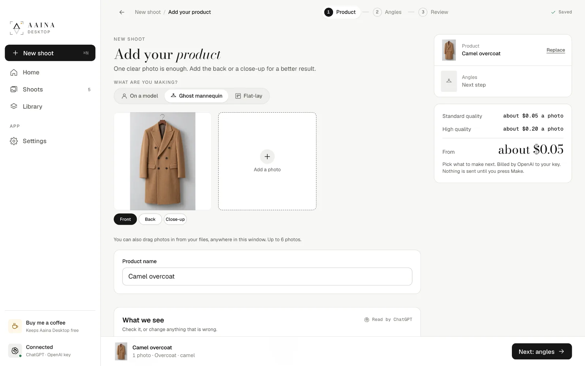
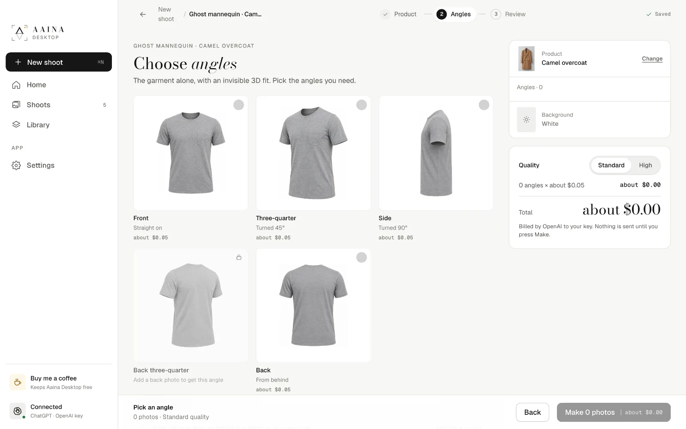
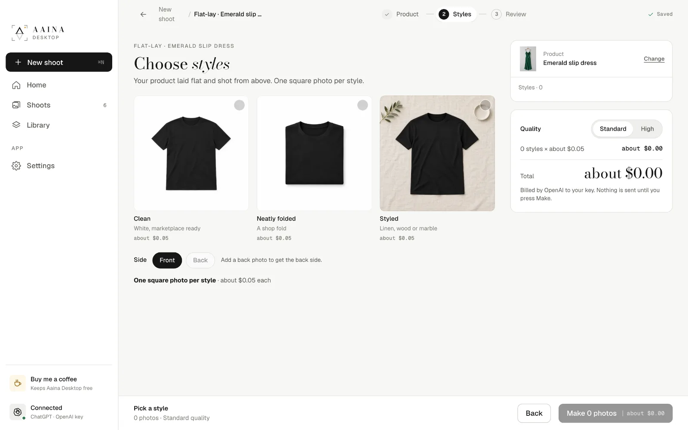

# 4. Ghost mannequin and flat-lay

Not every listing needs a model. Both of these start like any shoot: **New shoot**, pick **Ghost mannequin** or **Flat-lay**, and add the product.

## Ghost mannequin

The garment alone, in its worn 3D shape, as if on an invisible body, on a clean background. Choose the angles you need, each one photo:

- **Front**, **Three-quarter** (turned 45°) and **Side** (turned 90°).
- **Back three-quarter** and **Back**. A back photo of your product makes these exact; without one, the back three-quarter can't be made and the back is worked out from the front.

Clothing only: ghost mannequin is for garments, not bags, shoes or jewellery.

## Flat-lay

The product laid flat and shot from straight above, one square photo per style:

- **Clean:** on white, ready for marketplaces.
- **Neatly folded:** a shop fold.
- **Styled:** on linen, wood or marble, with a few quiet props.

Choose **Front** or **Back** (the back needs a back photo).

Both kinds open in the same viewer as model photos, with the same edits and saving.

Next: [Your own models](05-own-models.md)
