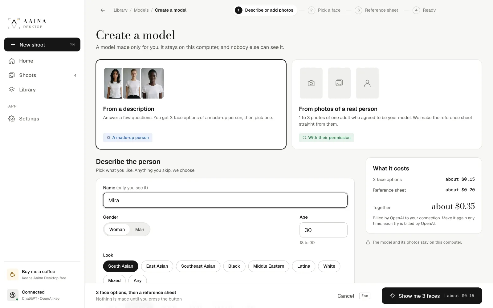
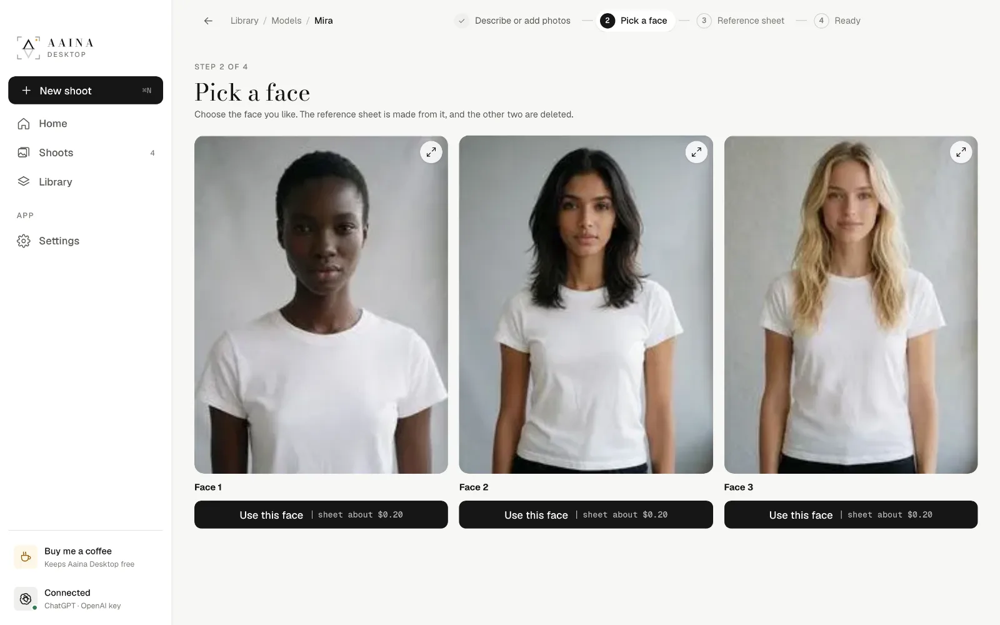
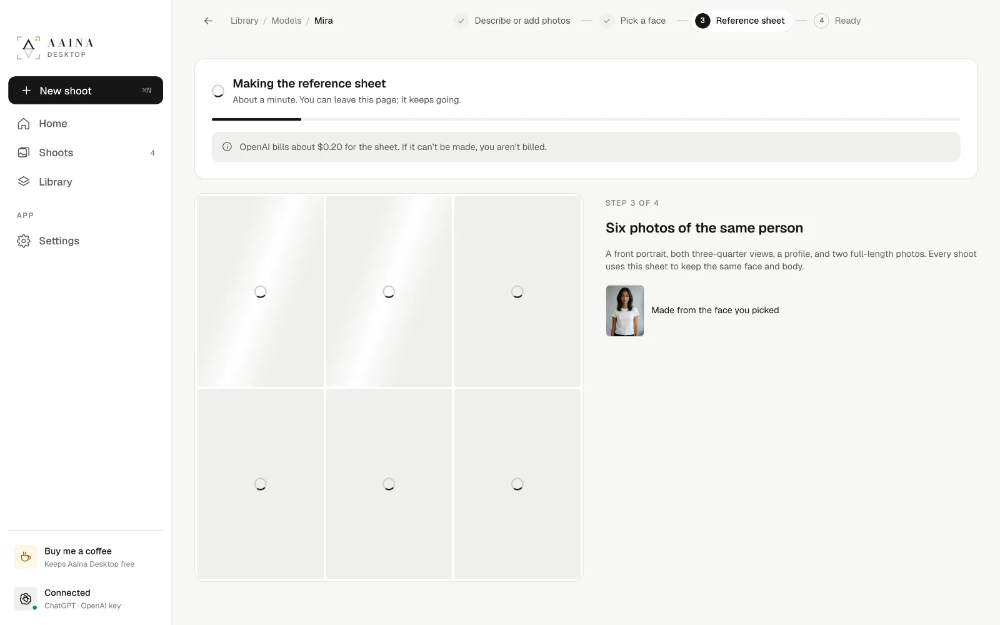
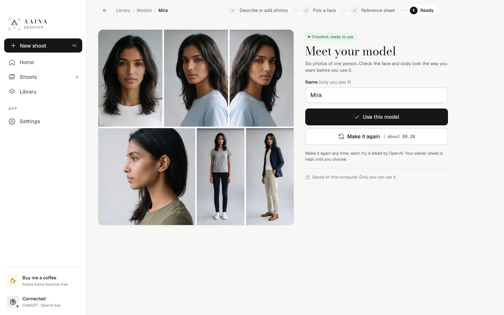

# 5. Your own models

The studio has hundreds of models, but you can also make one only you can use: your brand's face, a particular look, or a real person who agreed to be your model. Your models are kept on your computer and never shared.

Open **Library, Models, Create a model**, or **Create a model** on the model step of a shoot.

## From a description

Answer a few questions: name (only you see it), gender, age, look, body, hair and anything else you like ("freckles, round glasses"). Anything you skip, the app chooses. Press **Show me 3 faces** (about $0.15).

You get three faces of a made-up person. Pick the one you like with **Use this face**; the other two are deleted.

## From photos of a real person

Add 1 to 3 clear photos of one adult who has agreed to be your model, and the reference sheet is made straight from them. Only use photos of someone who has given you permission.

## The reference sheet

Every model, studio or your own, is one **reference sheet**: six photos of the same person (a front portrait, both three-quarter views, a profile and two full-length photos). It is what keeps the face and body the same in every photo you make. Making it takes about a minute (about $0.20), and it is checked automatically.

When it is ready, check the face and body. **Use this model** starts a shoot with it; **Make it again** makes a new sheet if you'd like a change (the earlier one is kept until you choose).

Your models use the studio's pose collection for their gender, so you have plenty of poses from the start, and you can make your own.

Next: [Your own poses and scenes](06-own-poses-and-scenes.md)
