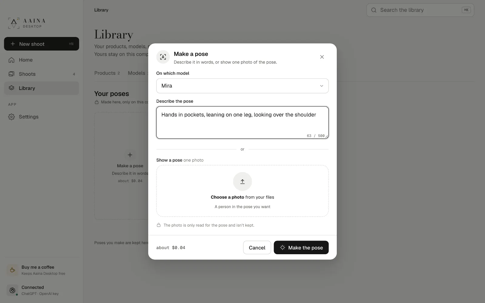
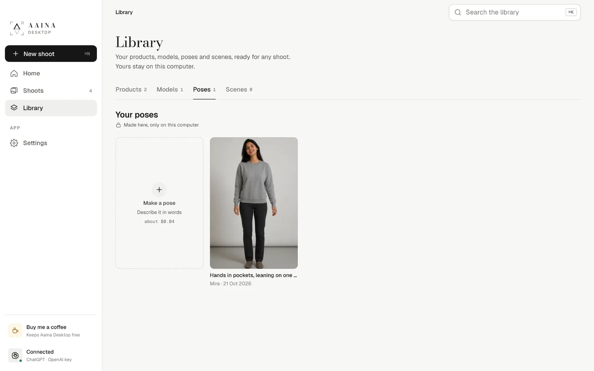
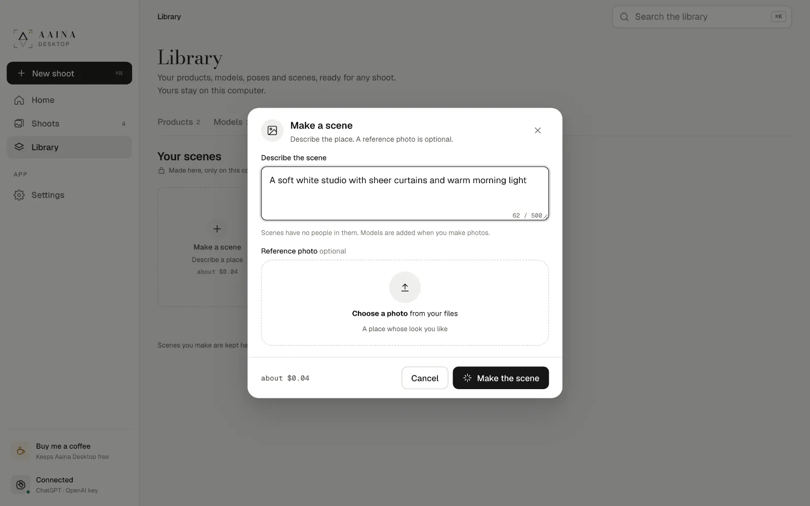
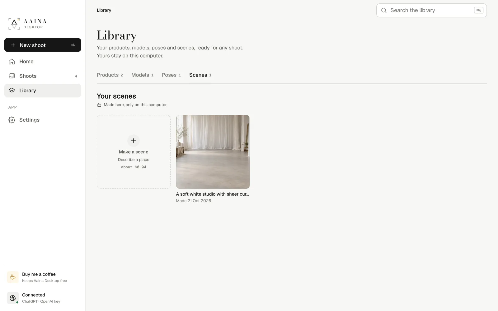

# 6. Your own poses and scenes

## Poses

When no studio pose is quite right, make one. In **Library, Poses, Make a pose** (or **Yours** on the pose step):

- **Describe it in words:** "hands in pockets, leaning on one leg, looking over the shoulder".
- **Or show a pose:** one photo of a person in the pose you want. The photo is only read for the pose and isn't kept.

Choose which model it is for, and press **Make the pose** (about $0.04).

The new pose shows up under Your poses, and in every shoot with that model.

On the pose step of a shoot you can also just **describe a pose** for that one photo, without saving it.

## Scenes

In **Library, Scenes, Make a scene** (or **Your own** on the scene step), describe the place: "a soft white studio with sheer curtains and warm morning light". Scenes never have people in them; the model is added when you make photos. You can add a reference photo of a place whose look you like. About $0.04.

## Plain colours

For a plain backdrop, use the **Colour** tab on the scene step: pick a swatch or type any hex code. Colours are free, and the ones you used are kept in Library, Scenes.

Next: [Shoots and Library](07-shoots-and-library.md)
