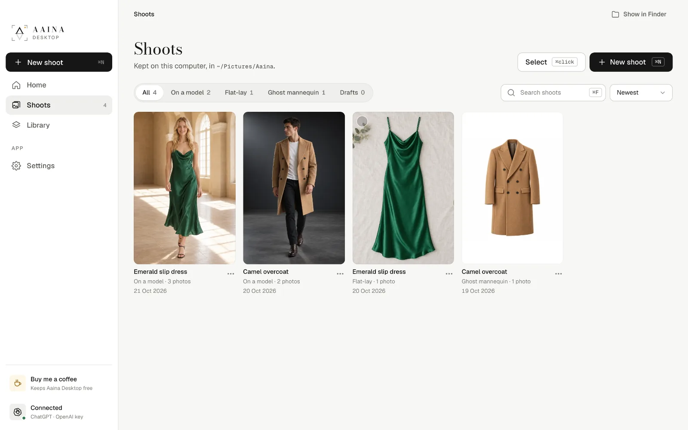
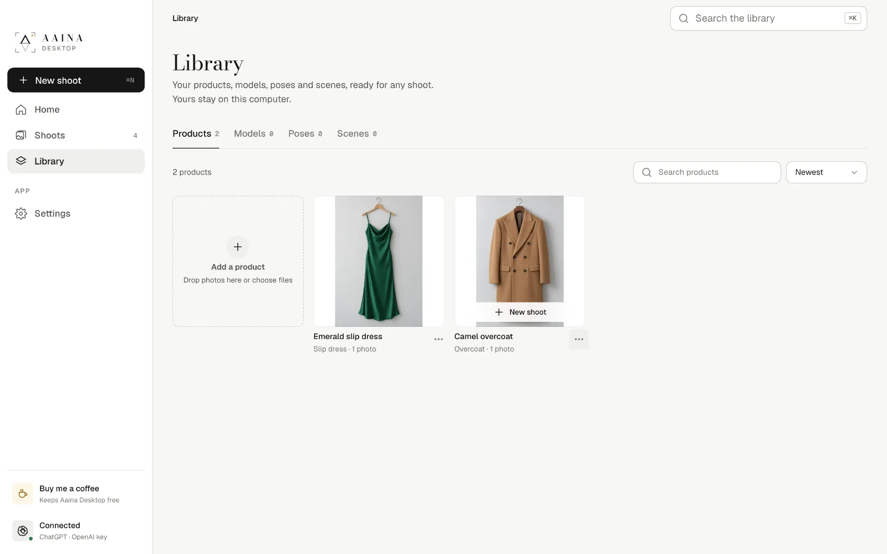

# 7. Shoots and Library

## Shoots

**Shoots** lists everything you made, newest first. Filter by kind (on a model, flat-lay, ghost mannequin, drafts), search by product or model (⌘F / Ctrl+F), and sort. A shoot you started but didn't make is kept as a **draft**, with every choice remembered.

Each shoot is also a folder of normal files in your photos folder; **Show in Finder** (or Explorer) opens it. **Select** (or ⌘-click) picks several shoots to save or delete at once.

## Library

**Library** keeps what you reuse across shoots:

- **Products:** every product you added, with its reading. Start a new shoot with one in a click.
- **Models:** your own models, and the full studio catalogue with filters and pins.
- **Poses** and **Scenes:** the ones you made, and colours you used.

Search anything from the top bar with ⌘K / Ctrl+K.

Next: [Settings, backup and privacy](08-settings.md)
