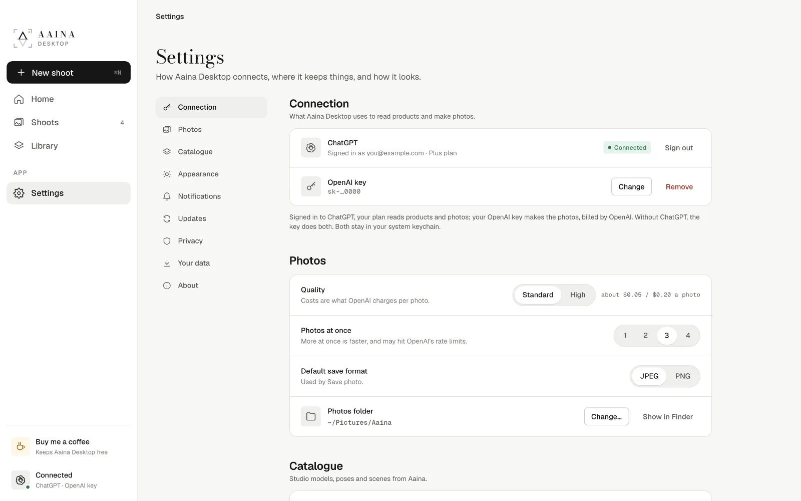
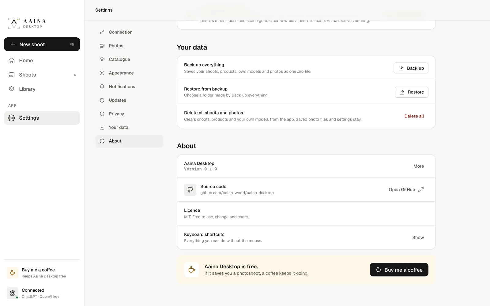

# 8. Settings, backup and privacy

- **Connection:** your ChatGPT sign-in and OpenAI key. Change or remove either at any time.
- **Photos:** default quality, how many photos are made at once (more is faster, but may hit OpenAI's limits on new accounts), the default save format, and your photos folder.
- **Catalogue:** when the studio catalogue was last updated, **Refresh**, and **Keep the catalogue for offline use** (up to about 1.2 GB), so you can browse without internet.
- **Appearance:** light, dark, or follow your computer.
- **Notifications:** a quiet notification when photos are ready.
- **Updates:** check for a new version, or have the app check when it opens. Nothing is installed without you.

## Your data

- **Back up everything:** your shoots, products, own models and photos as one file.
- **Restore from backup:** brings a backup back, for example on a new computer.
- **Delete all shoots and photos:** clears the app. Saved photo files and your settings stay.

## What is sent where

- **Stays on your computer:** your products, shoots, photos, own models, settings and your key (in the system keychain).
- **Sent to OpenAI:** your product photos, plus the model, pose and scene for each photo you make, with your own key or ChatGPT sign-in.
- **Sent to Aaina:** nothing. The app only downloads the public catalogue of studio models, poses and scenes. There is no account, no tracking and no ads.

The full details are in [PRIVACY.md](../../PRIVACY.md), and the code is open for anyone to read.

Back to the [tutorials](README.md).
